# iotserver 物联网平台

iotserver 是一个使用 **Go + React** 实现的轻量级物联网平台，前后端、部署编排与接入文档都在这一个仓库里。核心服务自研，单机即可完成部署，适合设备接入、数据采集、监控告警与可视化展示等场景。

- **轻量部署**：一个核心服务 + MQTT Broker + eKuiper，Docker Compose 一键启动。
- **数据可落地**：元数据使用 SQLite / MySQL；时序数据默认写入 DuckDB / DuckLake（也支持 LevelDB、TStorage、TDengine）。
- **多租户隔离**：一个实例服务多个租户，数据行级隔离，平台管理员可切换租户代管。
- **中英双语**：管理端、接口文案与告警通知均支持中文 / English。

## 架构

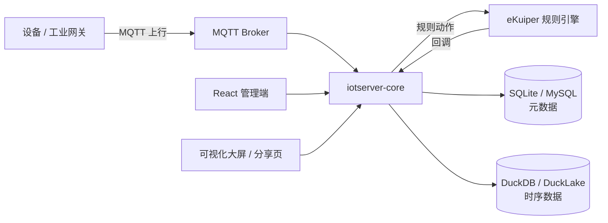

## 功能特性

| 模块 | 能力 |
| --- | --- |
| 产品管理 | 产品、物模型（属性 / 事件 / 服务）、数据格式与协议配置，支持从云端同步产品 |
| 设备管理 | 单个创建 / 批量导入、绑定产品与驱动、设备密钥、在线状态、物模型数据查询 |
| 网关管理 | 第三方工业网关 MQTT 接入、断点续传补传、配置与命令下发、在线状态 |
| 驱动与镜像 | 驱动实例、驱动市场、镜像仓库配置 |
| 机器模板 | 17 个内置工业产品模板（冷藏库/冷冻库/速冻隧道、压缩机/冷却塔、灌装机/贴标机、包装机/码垛机、注塑机/挤出机、生产线/数控机床、能源监测/光伏逆变器、工业网关），一键生成产品与告警 |
| 告警中心 | 告警规则、分级告警、忽略 / 处理，通知渠道支持邮件（SMTP / Twilio Email）、短信、WhatsApp 与 Webhook |
| 规则引擎 | 基于 eKuiper 的流式规则，规则生命周期由平台统一管理 |
| 场景联动 | 设备 / 时间条件触发的自动化联动与执行日志 |
| 数据中心 | 历史数据查询、数据保留策略 |
| 可视化 | 拖拽式看板编辑器、指标 / 趋势 / 排行榜等组件、大屏查看与分享链接 |
| 系统管理 | 用户、角色、菜单、部门、审查日志、系统配置，接口级 RBAC 权限 |
| 多租户 | 租户、配额、到期时间、数据保留策略；租户间数据隔离 |
| 国际化 | 管理端中英切换，接口与告警通知按请求语言返回 |

## 页面截图

| 首页看板 | 产品管理 |
| --- | --- |
| 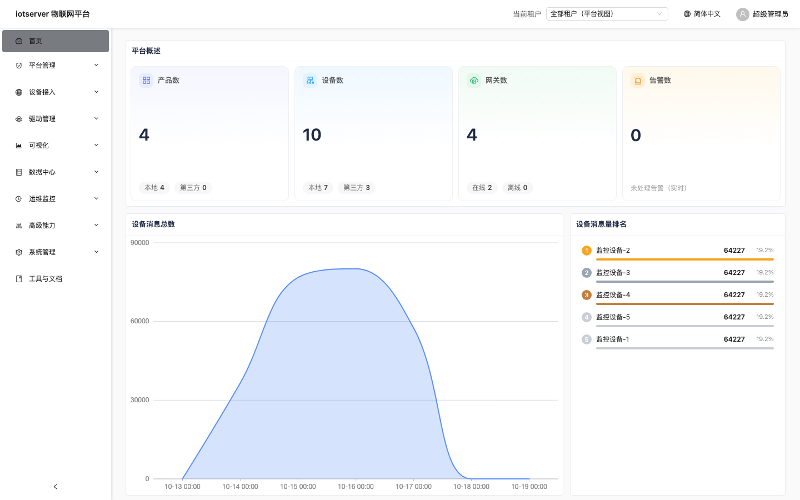 | 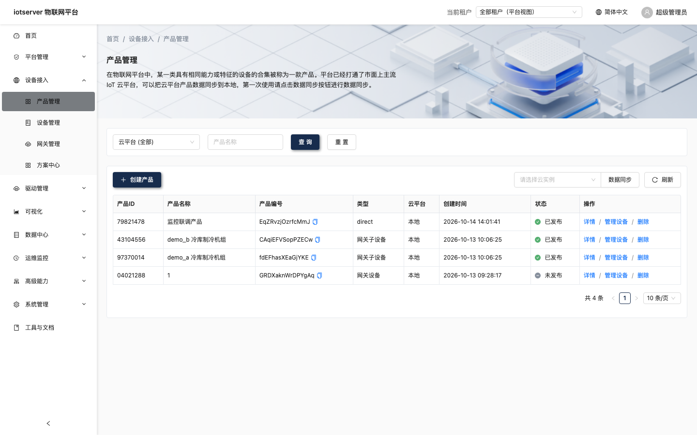 |
| **产品物模型** | **设备管理** |
| 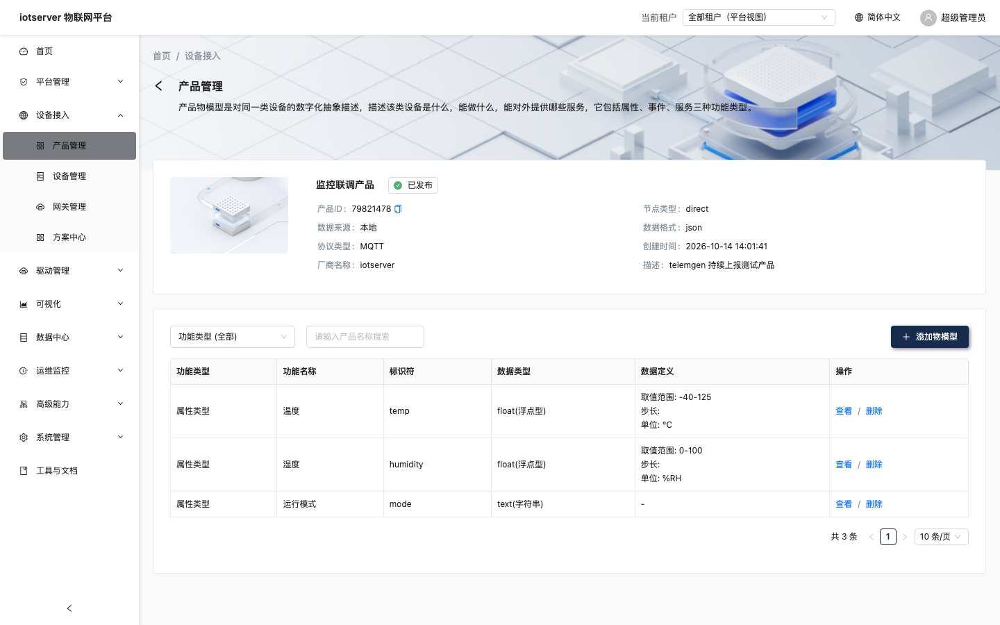 | 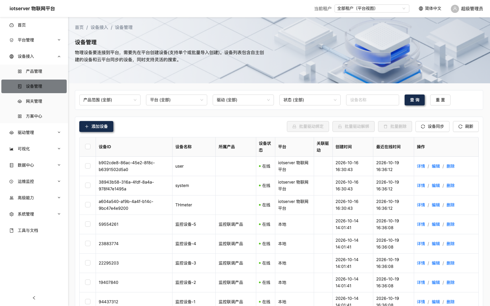 |
| **设备详情** | **网关管理** |
| 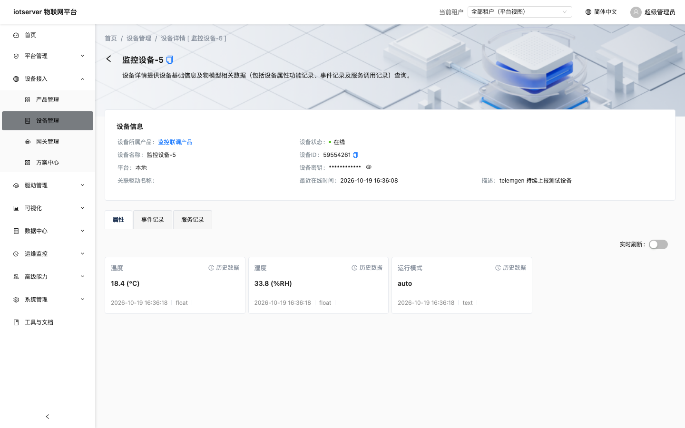 | 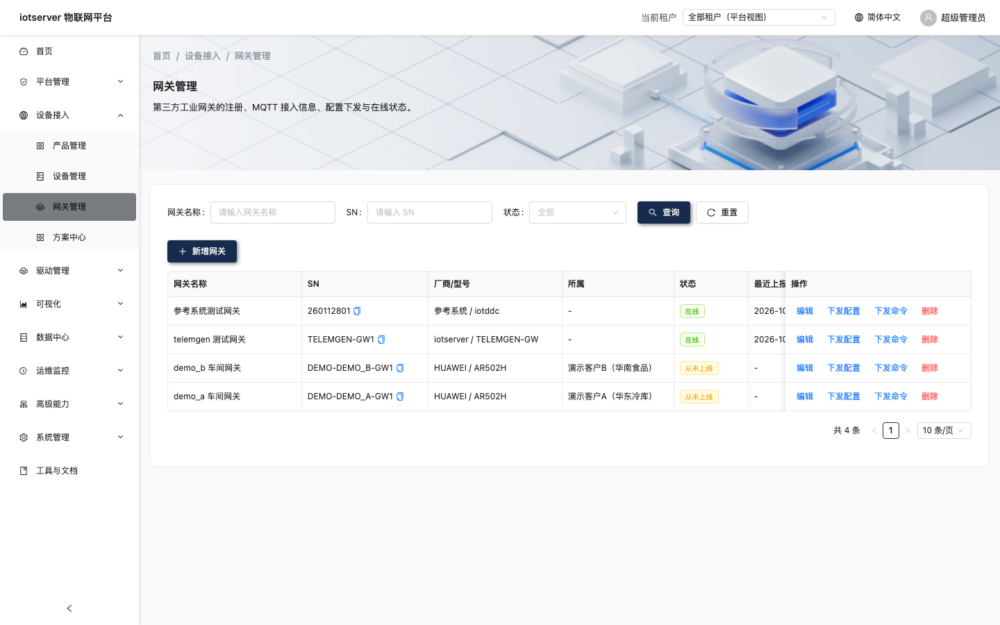 |
| **告警中心** | **场景联动** |
| 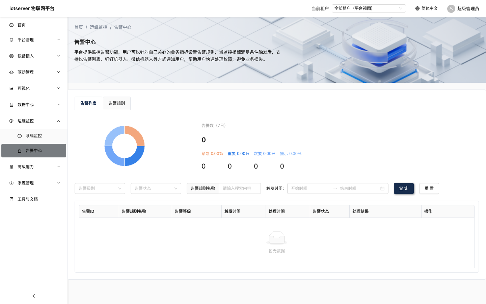 | 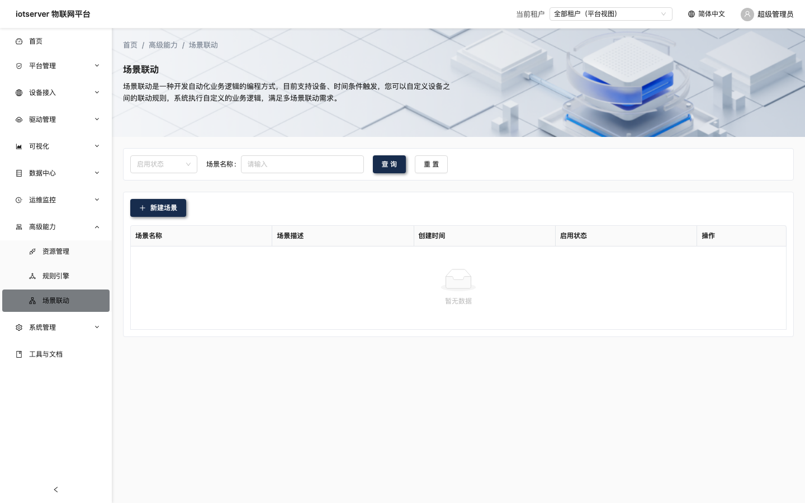 |
| **看板管理** | **租户管理** |
| 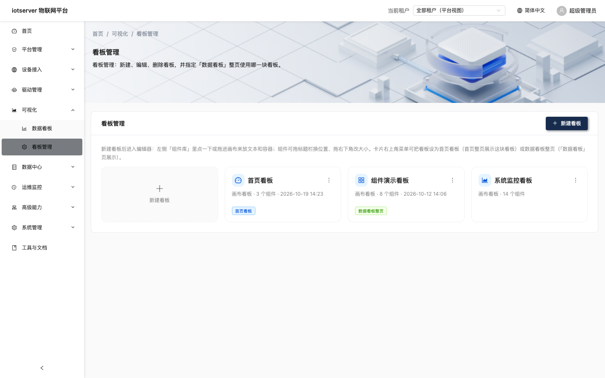 | 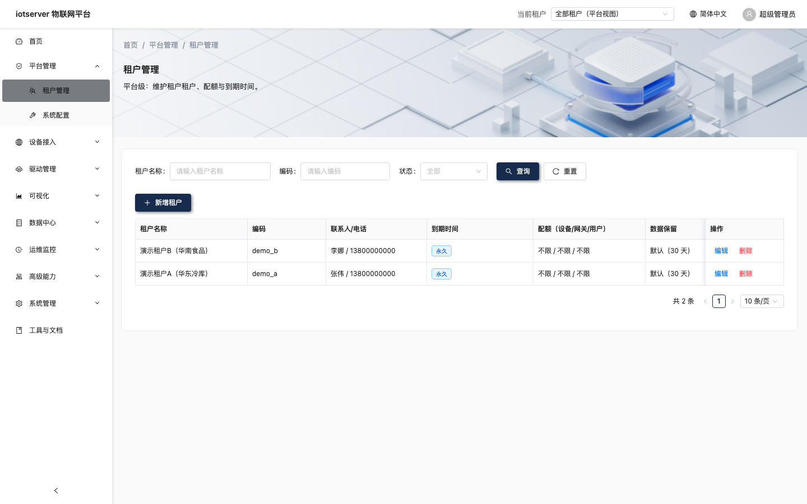 |

## 技术栈

| 层 | 技术 |
| --- | --- |
| 后端 | Go 1.24、Gin、GORM、Docker SDK |
| 元数据存储 | SQLite（默认，WAL）/ MySQL |
| 时序数据 | DuckDB / DuckLake（默认）、LevelDB、TStorage、TDengine |
| 规则引擎 | eKuiper 2.x |
| 消息接入 | MQTT |
| 前端 | React 18、TypeScript、Ant Design 5、i18next |
| 部署 | Docker、Docker Compose |

## 快速开始

前置：Docker（含 buildx）、Node 18+、Go 1.24+。

```bash
cd iotserver

# 1. 构建前端产物（Dockerfile 会把它打进镜像）
make ui

# 2. 构建镜像
#    推送到镜像仓库（部署到其它机器时用）
make docker IMAGE=<你的仓库>/iotserver-core:v1.0
#    或只构建到本机（本机直接启动，不推送）
make docker PUSH=0 IMAGE=iotserver-core:v1.0

# 3. 启动
cd manifest/docker
docker compose up -d

#    若第 2 步推送到了镜像仓库，启动时指定同一镜像：
#    IOTSERVER_IMAGE=<你的仓库>/iotserver-core:v1.0 docker compose up -d
```

访问入口：

| 入口 | 地址 | 说明 |
| --- | --- | --- |
| 管理端（前端 + API） | `http://<host>:3000` | 默认账号 `admin` / `admin123` |
| 内部 API | `http://<host>:58081` | eKuiper 规则回调使用 |
| eKuiper REST | `http://127.0.0.1:9081` | 仅绑定本机回环 |
| eKuiper Manager | `http://<host>:9082` | 规则 / 流可视化管理 |

数据目录：

| 数据 | 位置 |
| --- | --- |
| 元数据（用户、设备、规则、场景等） | `iotserver/manifest/docker/db-data/core-data/core.db` |
| 历史数据 | `iotserver/manifest/docker/db-data/ducklake/` |
| eKuiper 数据 | `iotserver/manifest/docker/kuiper/` |

> DuckLake 首次启动需要联网安装 `ducklake` 扩展（缓存在 catalog 同目录的 `extensions/`，之后可离线）。
> 纯离线环境请预热该目录，或将 `Databases.Data.Primary.Type` 改为 `leveldb` / `tstorage`。

常用命令（在 `iotserver/` 目录执行）：

```bash
make test                                  # 后端全部测试
go run ./tools/lakectl stats               # DuckLake 行数 / 快照数 / 数据文件数
go run ./tools/lakectl flush|purge|compact # 刷盘 / 按保留期清理 / 压实（需先停服务）
go run ./tools/gen-permissions             # 调整权限后重新生成前端权限常量
make start                                 # go run 直接启动（启动前自动保证前端产物最新）
make ui                                    # 前端：构建 + 同步到 cmd/iotserver-ui/build
```

## 目录结构

```text
.
├── iotserver/           # Go 后端、部署编排、接入文档
│   ├── cmd/             # 服务入口与前端静态产物
│   ├── internal/        # 业务实现
│   ├── manifest/        # Docker Compose、初始化 SQL 等
│   └── docs/            # 网关接入、多租户、数据层等设计文档
├── iotserver-ui/        # React 管理端
└── docs/screenshots/    # README 截图
```

## 文档

- [网关接入规范](iotserver/docs/gateway-integration.md)
- [设备接入设计](iotserver/docs/device-access-design.md)
- [多租户隔离审计](iotserver/docs/multi-tenant-audit.md)
- [时序数据层迁移说明](iotserver/docs/duckdb-migration-plan.md)

## 参与贡献

1. 从 `master` 拉出新分支，命名示例：`feature/<name>/<description>`。
2. 提交前请确保后端 `make test` 通过、前端可以正常构建。
3. 提交 Pull Request，说明改动内容与验证方式。

## 开源协议

本项目遵循 [Apache License 2.0](LICENSE)。
