

	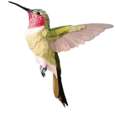
 

# 产品简介

iotserver 是 Golang 语言实现的超轻量级物联网开发平台，他的核心服务完全由团队自行研发，从这个平台设计之初，轻量级、性能优异当作我们的一条开发准则。所以它服务都是采用Golang语言编写，占用内存极低。在数据存储上，我们创新的使用了SQLite和LevelDB当作了我们存储数据库，得益于SQLite的轻量级和LevelDB对数据的高吞吐和高压缩的特点， 经过实际测试，在1C/1G 100G存储的物理机上，可实现数千设备的连接和8000W条的消息存储。

当然，如果您对数据有可靠行、海量存储等要求，您完全可以把SQLite和LevelDB换为MySQL和TDengine，iotserver 兼容多种数据库连接，用户可以根据自己的业务需要选择适合自己的数据库。

“麻雀虽小，五脏俱全”，虽然 iotserver 作为一个超轻量级物联网平台，但是他的核心功能并不会消减。设备接入、产品管理、物模型、告警中心、规则引擎...这些所有物联网平台的标配功能，都可以在本平台中找到。

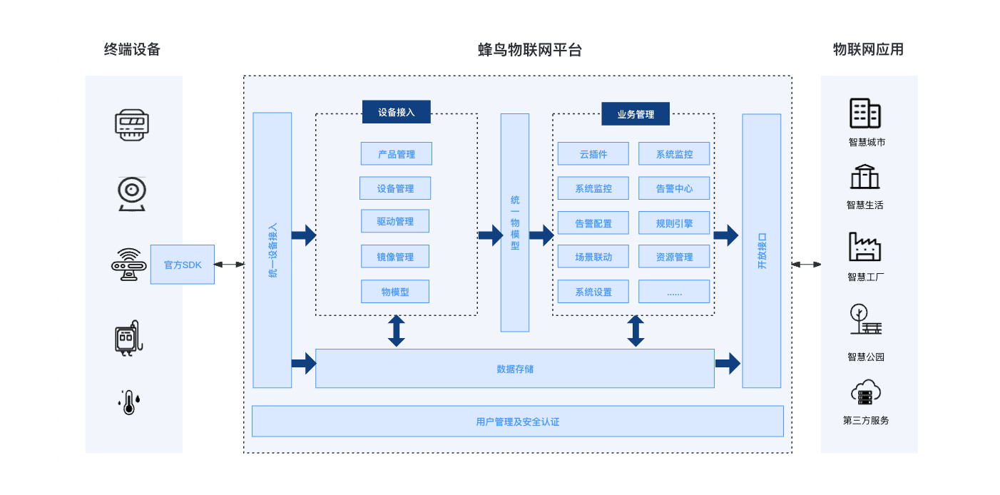

# 部分页面展示

| 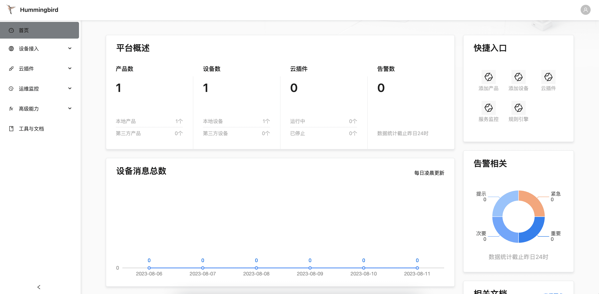 | 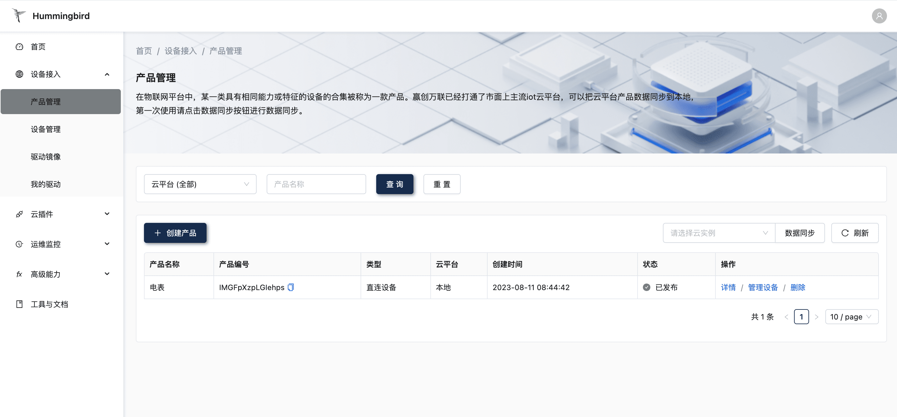  |
|:--------------------------|:---------------------------|
| 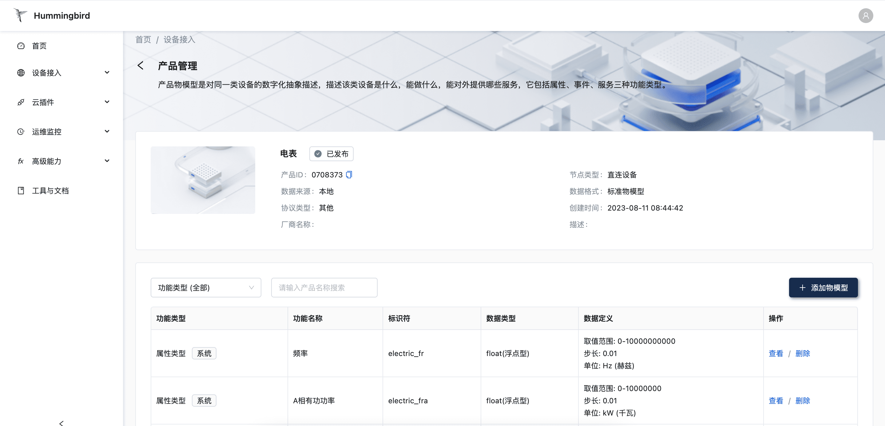 | 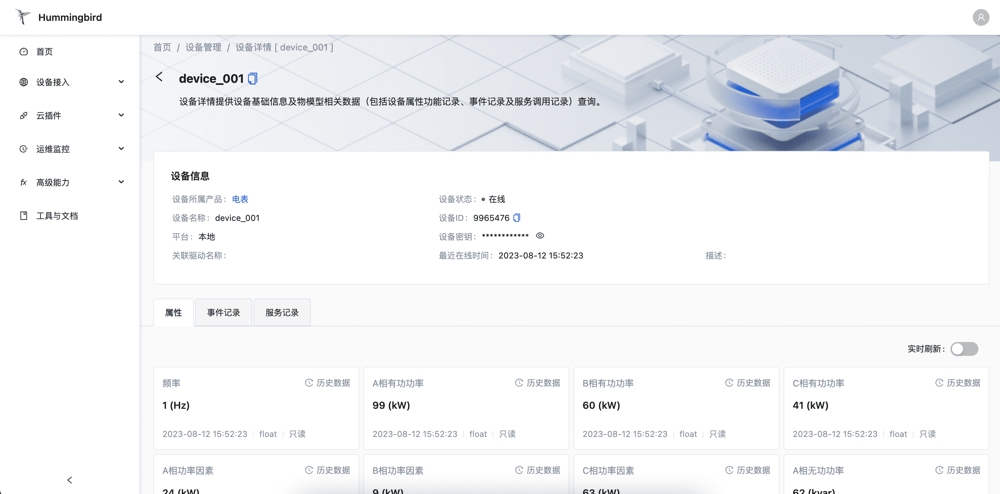  |
| 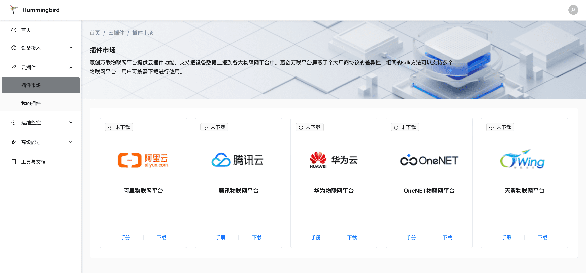 | 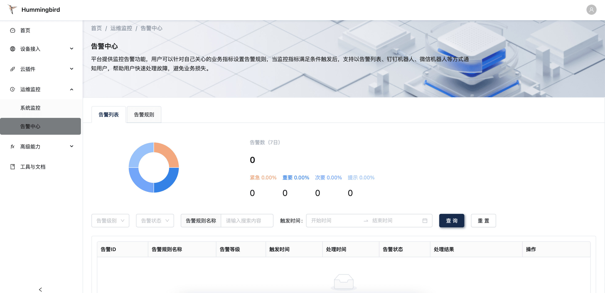  |
| 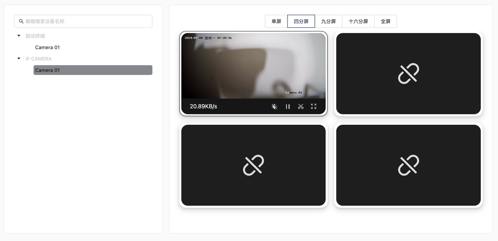 | 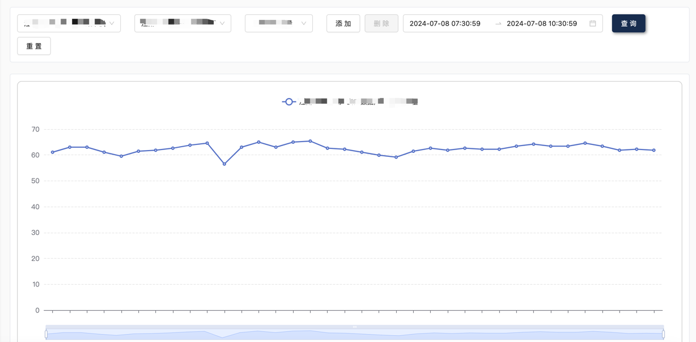 |
| 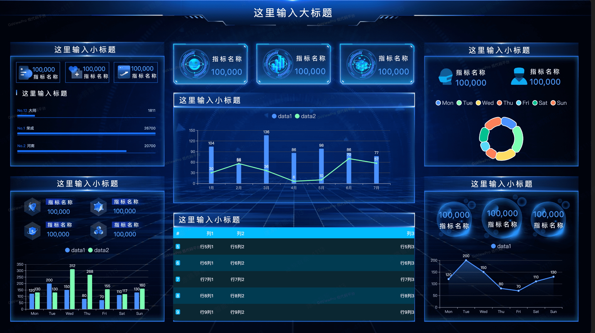 |   |

# 小程序页面展示

| 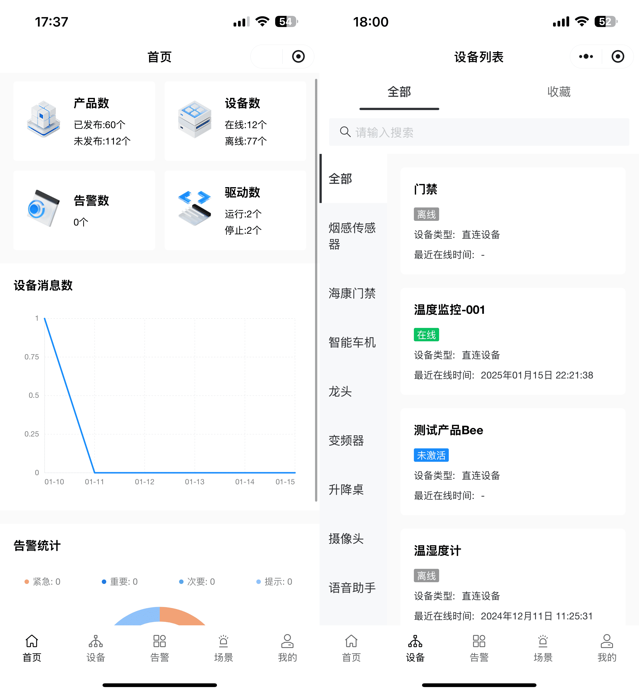 | 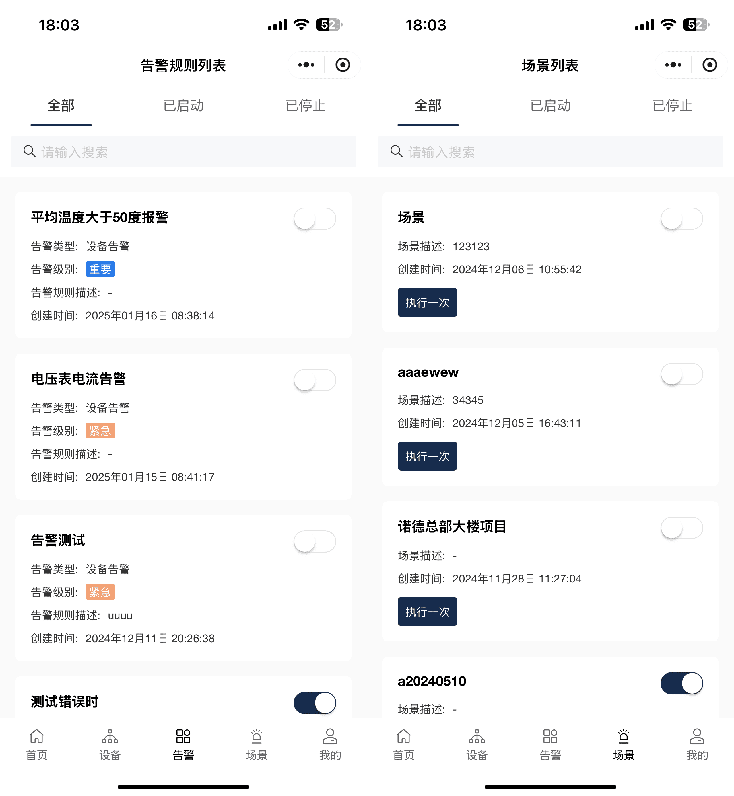 |
|:---------------------------------------|:---------------------------------------|
| 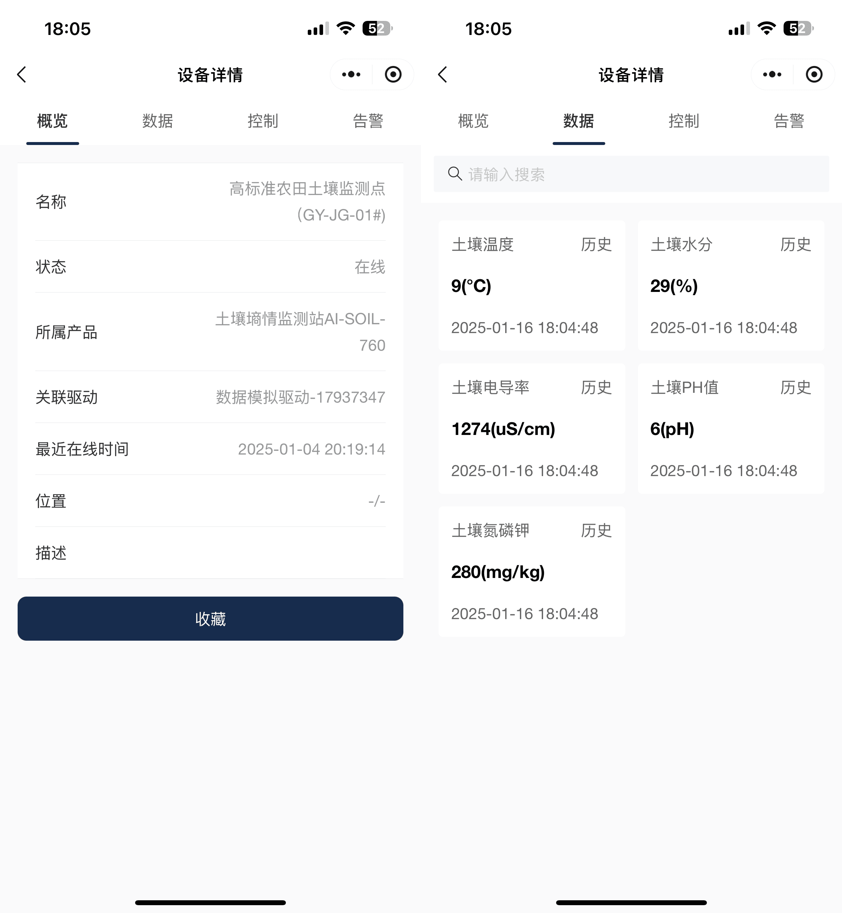 | 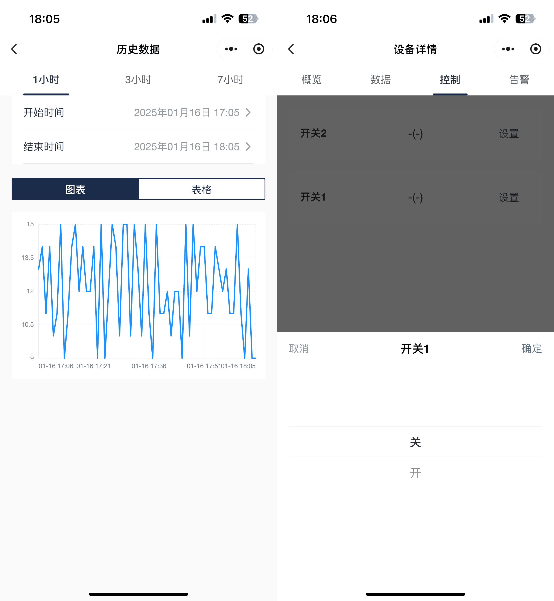 |

# 快速启动

git clone <你的仓库地址> iotserver

cd iotserver/manifest/docker 

docker-compose up -d

# 主要功能

- 产品管理
- 设备管理
- 镜像管理
- 驱动管理
- 驱动市场
- 系统监控
- 告警中心
- 资源管理
- 规则引擎
- 场景联动
- 插件市场
- 数据大屏
- 系统管理（用户 / 角色 / 菜单 / 部门 / 登入日志 / 系统配置 / 个人中心）

# 系统管理（RBAC）

系统管理模块位于前端导航「系统配置」下，包含 7 个子模块：

| 前端路由               | 功能     | 主要接口                                                       |
| ---------------------- | -------- | -------------------------------------------------------------- |
| `/admin/sysUser`       | 用户管理 | `GET/POST/PUT/DELETE /api/v1/sys-user`、`PUT /api/v1/pwd/reset/:id` |
| `/admin/sysRole`       | 角色管理 | `/api/v1/role`、`/api/v1/menurole`                              |
| `/admin/sysMenu`       | 菜单管理 | `/api/v1/menu`、`/api/v1/menu/tree`                             |
| `/admin/sysDept`       | 部门管理 | `/api/v1/dept`、`/api/v1/dept-tree`                             |
| `/admin/sysLoginLog`   | 登入日志 | `/api/v1/sys-login-log`、`/api/v1/sys-login-log/clear`          |
| `/admin/sysSet`        | 系统配置 | `/api/v1/system-setup`、`/api/v1/system-setup/save`             |
| `/common/userProfile`  | 个人中心 | `GET/PUT /api/v1/user/profile`、`GET /api/v1/user/getinfo`      |

**权限模型**

- 用户通过 `sys_user_role` 关联角色，角色通过 `sys_role_menu` 关联菜单，菜单的 `perms` 字段即接口权限标识（例如 `system:user:add`）。
- 前端登录后按「用户可见菜单 + 权限标识」动态渲染导航与操作按钮。
- 后端在每个系统管理接口前挂载 `middleware.PermRequired` 中间件做接口级鉴权；拥有内置角色 `admin`（`role_key = admin`）的账号直通全部接口。
- 内置管理员账号 `admin` 与内置角色 `超级管理员` 受保护：不可删除、不可停用。

**全站权限覆盖**

除系统管理外，产品/设备/驱动/镜像/告警/监控/文档等模块的接口同样已接入权限校验，共覆盖 97 个接口：

| 模块 | 权限前缀 | 覆盖接口 |
| --- | --- | --- |
| 产品管理 | `gateway:product:*` | 产品增删改查、物模型维护 |
| 设备管理 | `gateway:device:*` | 设备增删改查、导入、绑定驱动/产品、物模型数据查询 |
| 驱动镜像 | `gateway:image:*` | 镜像仓库配置增删改查 |
| 我的驱动 | `gateway:drive:*` | 驱动库与驱动实例的增删改查 |
| 系统监控 | `monitor:system:view` | 系统指标 |
| 告警中心 | `monitor:alert:*` | 告警规则、告警列表、忽略/处理 |
| 工具与文档 | `docs:view` | SDK 文档 |
| 首页 | `home:view` | 首页概览 |

**权限码单一来源**

权限标识只在 `internal/pkg/permissions/permissions.go` 定义一次：

- 后端路由用 `middleware.Perm(...)` 引用；
- 数据库菜单与按钮权限由 `internal/pkg/seed` 依据同一份定义生成；
- 前端常量由 `go run ./tools/gen-permissions` 生成到 `iotserver-ui/src/routes/permissions.ts`。

新增模块时只需：① 在 `permissions.go` 加权限码；② 在 `seed` 里加菜单与按钮；③ 路由挂 `middleware.Perm`；④ 重新生成前端常量并给前端菜单项标注 `perm`。

**建表与初始化数据**

服务启动时会自动执行 `AutoMigrate` 创建 `sys_user_role`、`sys_role`、`sys_role_menu`、`sys_menu`、`sys_dept`、`sys_login_log`、`sys_config` 表，并为 `user` 表补齐系统管理所需字段，同时幂等地写入：

- 内置部门「蜂鸟物联网」
- 「系统配置」目录及 7 个子菜单，含全部按钮权限
- 内置角色「超级管理员」并授予全部菜单
- 默认管理员账号 `admin / admin123`（仅当 `admin` 账号不存在时创建）
- 默认系统配置项（平台名称、会话超时、密码策略、数据保留等）

# 产品优势

- **免费开源**：我们源代码全部开源，可供个人学。
- **性能优异**：经过实际测试，在2C4G主机上，可支持60k的设备连接。模拟4k设备以1000ms的间隔向服务端发送16kb长度的属性数据，cpu使用率稳定在百分之60、内存使用率稳定在百分之16。
- **多数据支持**：平台支持SQLite、LevelDB和MySQL、TDengine数据库，用户可以根据自己的项目需要，选择适合自己的数据库。
- **支持可视化大屏**：用户只需要进行简单拖拽，无需写任何代码，即可完成可视化大屏开发设计。
- **内置产品模版库**： 平台内部预置产品模版（390条），帮助用户一键创建产品。
- **文档清晰**：平台文档清晰完整，文档内部有大量使用案例和视频教程，帮助用户快速理解产品和使用产品。
- **部署简单**：平台所有服务都是以docker形式运行，支持docker-compose命令一键启动。
- **成本优势**：在中小型物联网项目（设备数<=5000）中，只需要2C4G主机即可，并且还可以支持本地部署。

#  联系我们

我们开通了交流群，在使用在本品的过程中有任何问题，可以进群沟通。

| 微信群                (先加好友备注加群)                                                     | QQ群                                                                       |
|:------------------------------------------------------------------------|:--------------------------------------------------------------------------|
|  | 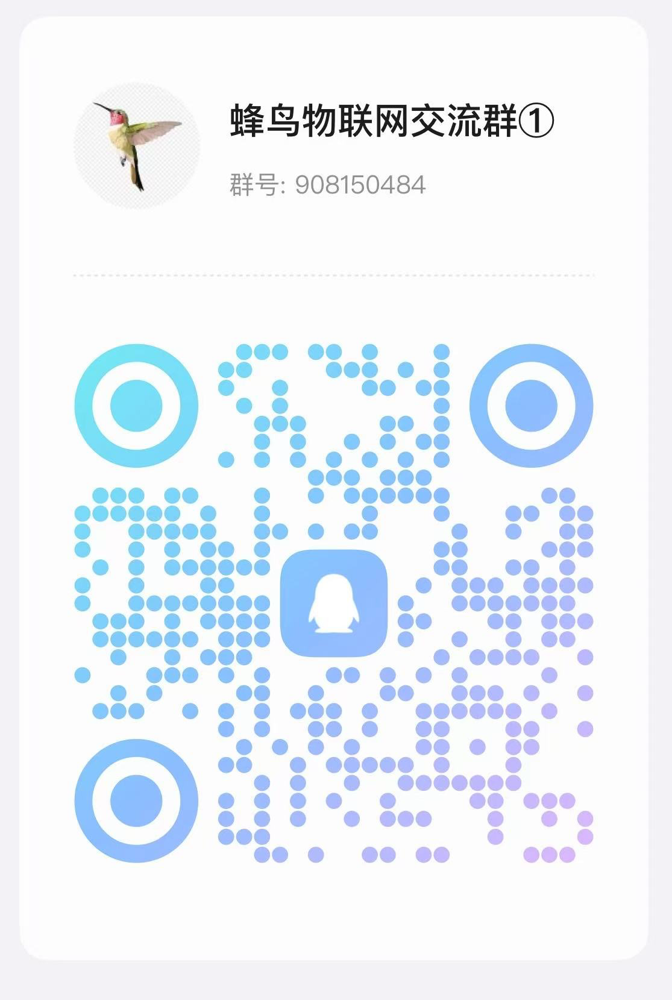 |

# 开源贡献

-   从 `master` 分支 `checkout` 一个新分支（**注**：请务必保证 `master` 代码是最新的）
-   新分支命名格式：`feature/username/description`，例如：`feature/pick/mqtt_driver`
-   在新分支上编辑文档、代码，并提交代码
-   提交 `PR` 合并到 `develop` 分支，等待作者合并即可

# 开源协议

`iotserver` 开源平台遵循 [Apache 2.0 协议](https://www.apache.org/licenses/LICENSE-2.0.html) 如果你想把 iotserver 平台进行商用，请提前找作者授权！

## 时序数据后端

`configuration.toml` 的 `[Databases.Data.Primary]` 支持四种数据层：

| Type | 说明 | 额外配置 |
| --- | --- | --- |
| `leveldb` | 默认，本地 KV | `DataSource` = 数据目录 |
| `tstorage` | 本地时序库 | `DataSource` = 数据目录 |
| `tdengine` | 远程时序库 | `Dsn` |
| `ducklake` | DuckDB + Parquet 湖仓 | `DataSource` = catalog 路径，`Dsn` = Parquet 目录 |

`ducklake` 使用官方 DuckDB Go 驱动，要求 **Go ≥ 1.24** 且 **CGO 开启**，运行镜像需 glibc。
`ducklake` 扩展首次需联网安装，之后缓存在 catalog 同级的 `extensions/` 目录（可离线预置）。
catalog 为单写者，同一湖同一时刻只允许一个进程访问。
